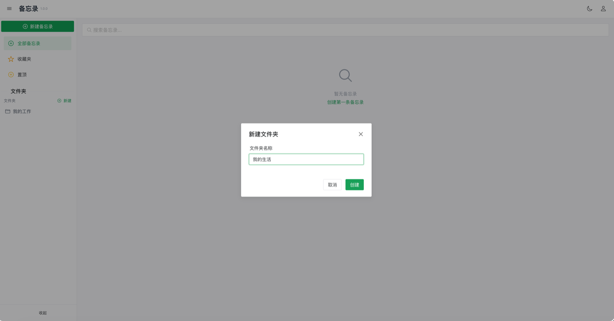
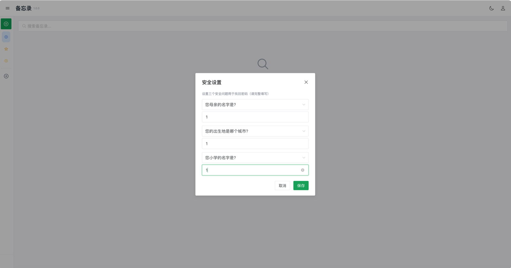

# 备忘录

一款支持多用户、自适应 PC/移动端的备忘录应用，采用 Vue 3 + Go + SQLite 技术栈，单文件部署，开箱即用。

> 📋 **[查看更新日志 → CHANGELOG.md](./CHANGELOG.md)**

## 下载与安装

| 渠道 | 获取方式 |
|---|---|
| GitHub Releases | <https://github.com/TechFunWay/memo/releases> —— 各平台压缩包、飞牛 `fpk` 安装包与 `docker-compose.yml` |
| Gitee 镜像 | <https://gitee.com/TechFunWay/memo> —— 代码自动同步自 GitHub，发行版待补 |
| Docker 镜像 | `docker pull techfunways/memo:latest`（amd64 / arm64 多平台） |
| 飞牛 fnOS | 在飞牛应用中心手动安装 Releases 里的 `.fpk` 安装包（amd64 / arm64） |
| 官网介绍页 | <https://techfunway.wycto.cn/fnapp/memo> |

> 默认端口 `8905`；数据默认是挂载目录下的 SQLite 单文件，备份即拷贝，恢复支持上传本地备份文件。

## 界面预览

| 登录 | 文件夹管理 | 账号与安全 |
|---|---|---|
|  |  |  |

## ✨ 特性

- 🎨 **美观界面**: Naive UI + Tailwind CSS，支持深色模式
- 📱 **响应式设计**: 自动适配 PC 端和移动端
- ✍️ **富文本编辑**: 加粗/斜体/下划线/删除线、文字颜色与高亮、有序无序列表、标题、清除格式
- 📌 **置顶与收藏**: 重要备忘录一键置顶、收藏，置顶项排在最前
- 🔐 **多用户支持**: 完整的用户认证与权限管理，管理员后台可增删改用户
- 🔑 **三重安全问题找回密码**: 设置三个安全问题，忘记密码答全后自助重置
- 📷 **图片上传**: 支持剪贴板粘贴和拖拽上传
- 📂 **文件夹管理**: 树形文件夹分类
- 🔍 **搜索与分页**: 按标题/正文快速查找，列表自动分页
- 🕐 **时间记录**: 同时显示创建时间与更新时间（北京时间）
- ⚙️ **系统配置**: 管理员可控制注册开关等配置
- 🚀 **一键部署**: 单文件部署，支持二进制、Docker、飞牛 NAS 三种方式

## 🚀 快速开始

### 方式一：二进制直接运行

```bash
# 解压后直接运行
./memo

# 浏览器访问 http://localhost:8905
# 第一个注册的用户自动成为管理员
```

### 方式二：Docker

```bash
docker run -d \
  --name memo \
  -p 8905:8905 \
  -v ./data:/app/data \
  techfunways/memo:latest
```

### 方式三：飞牛 NAS

在应用中心手动安装 `.fpk` 包即可。

---

## 🧪 本地模拟正式环境

使用 `make dev` 会编译前端和当前系统平台的后端二进制，并按正式发布包结构组装到项目根目录的 `dev/`：

```bash
make dev

# 使用自定义端口
make dev PORT=8080
```

目录结构：

```text
dev/
├── memo             # 编译后的后端程序
├── start.sh         # 独立启动脚本
├── www/             # 前端构建产物
└── data/            # 数据库、上传文件和日志
```

构建完成后服务以前台方式运行，默认访问地址为 `http://localhost:8905`，按 `Ctrl+C` 停止。

重复执行 `make dev` 时：

1. 重新编译前端与后端；
2. 替换 `dev/memo` 和 `dev/www/`；
3. 保留 `dev/data/` 中的运行数据；
4. 检测目标端口，先尝试正常停止占用进程，未及时退出时再强制停止；
5. 从 `dev/` 目录启动新程序。

也可以在完成一次构建后直接运行：

```bash
./dev/start.sh
```

---

## 🔧 启动参数

| 参数 | 默认值 | 说明 |
|------|--------|------|
| `-port` | `8905` | 服务监听端口 |
| `-data-dir` | `./data` | 数据目录（数据库、上传文件、日志） |
| `-web-dir` | `./static` | 前端静态文件目录 |

```bash
# 自定义端口和数据目录
./memo -port 8080 -data-dir /var/lib/memo/data

# 仅修改端口
./memo -port 9000
```

---

## 🐳 Docker 部署详解

### 端口映射

```bash
# 宿主机 8080 → 容器 8905
-p 8080:8905
```

### 数据持久化

容器内数据目录 `/app/data`，建议挂载到宿主机：

```bash
-v /宿主机路径/data:/app/data
```

容器内数据目录结构：

```
/app/data/
├── db/
│   └── database.db      # SQLite 数据库（核心数据，请定期备份）
├── upload/               # 上传的图片文件
└── logs/                 # 运行日志
```

### 完整示例

```bash
docker run -d \
  --name memo \
  -p 8905:8905 \
  -v /etc/memo/data:/app/data \
  -e TZ=Asia/Shanghai \
  --restart unless-stopped \
  techfunways/memo:latest
```

### Docker Compose

发布包内已附带两个开箱即用的 compose 文件（位于 `release/v<版本>/`）：

- **`docker-compose-v<版本>.yml`** — 固定版本部署，稳定不变。
- **`docker-compose-latest.yml`** — 跟随 `latest`，并内置 [Watchtower](https://containrrr.dev/watchtower/) 每小时自动检查更新（仅更新本应用容器并清理旧镜像）。

```bash
# 固定版本
docker compose -f docker-compose-v1.1.1.yml up -d

# 跟随最新版并自动更新
docker compose -f docker-compose-latest.yml up -d
```

最简手写示例：

```yaml
services:
  memo:
    image: techfunways/memo:latest
    container_name: memo
    ports:
      - "8905:8905"
    volumes:
      - ./data:/app/data
    restart: unless-stopped
```

```bash
docker compose up -d
```

### 升级

```bash
docker pull techfunways/memo:latest
docker stop memo && docker rm memo
# 用同样参数重新启动（数据卷不变，数据不丢失）
docker run -d --name memo -p 8905:8905 -v ./data:/app/data techfunways/memo:latest
```

---

## 🏠 飞牛 NAS 部署

1. 下载对应架构的 `.fpk` 包
2. 打开飞牛 NAS 桌面 → **应用中心** → **手动安装**
3. 选择 `.fpk` 文件，按向导完成安装
4. 访问 `http://<你的NAS IP>:8905`

---

## 📁 数据目录结构

```
data/
├── db/
│   └── database.db      # SQLite 数据库（核心数据！）
├── upload/               # 上传的图片（按 YYYYMMDD 分类）
└── logs/                 # 运行日志
```

> `database.db` 是核心数据文件，请定期备份。升级时替换二进制或镜像即可，数据库会自动迁移。

---

## 📖 API 参考

### 认证

| 方法 | 路径 | 说明 | 认证 |
|------|------|------|------|
| POST | `/api/auth/register` | 用户注册 | 否 |
| POST | `/api/auth/login` | 用户登录 | 否 |
| GET | `/api/auth/check` | 检查认证状态 | 否 |
| GET | `/api/auth/has-users` | 检查是否有用户 | 否 |
| GET | `/api/auth/security-question` | 获取安全问题 | 否 |
| POST | `/api/auth/verify-security` | 验证答案并重置密码 | 否 |
| GET | `/api/auth/me` | 获取当前用户 | 是 |
| PUT | `/api/auth/password` | 修改密码 | 是 |
| PUT | `/api/auth/security-question` | 设置安全问题 | 是 |
| GET | `/api/auth/security-question/check` | 检查是否已设置安全问题 | 是 |

### 备忘录

| 方法 | 路径 | 说明 | 认证 |
|------|------|------|------|
| GET | `/api/memos` | 获取备忘录列表 | 是 |
| POST | `/api/memos` | 创建备忘录 | 是 |
| GET | `/api/memos/:id` | 获取详情 | 是 |
| PUT | `/api/memos/:id` | 更新备忘录 | 是 |
| DELETE | `/api/memos/:id` | 删除备忘录 | 是 |

### 文件夹

| 方法 | 路径 | 说明 | 认证 |
|------|------|------|------|
| GET | `/api/folders` | 获取文件夹列表 | 是 |
| POST | `/api/folders` | 创建文件夹 | 是 |
| PUT | `/api/folders/:id` | 更新文件夹 | 是 |
| DELETE | `/api/folders/:id` | 删除文件夹 | 是 |

### 用户管理（仅管理员）

| 方法 | 路径 | 说明 | 认证 |
|------|------|------|------|
| GET | `/api/users` | 用户列表 | 管理员 |
| POST | `/api/users` | 新增用户（仅普通用户） | 管理员 |
| PUT | `/api/users/:id` | 编辑用户 | 管理员 |
| DELETE | `/api/users/:id` | 删除用户 | 管理员 |
| POST | `/api/users/:id/toggle` | 启用/禁用 | 管理员 |
| POST | `/api/users/:id/reset-password` | 重置密码 | 管理员 |

### 其他

| 方法 | 路径 | 说明 | 认证 |
|------|------|------|------|
| GET | `/api/version` | 版本信息 | 否 |
| POST | `/api/upload/image` | 上传图片 | 是 |
| GET | `/api/config/public` | 公开配置 | 否 |

---

## 💡 注意事项

1. **第一个注册的用户自动成为管理员**，系统仅允许一个管理员，后台新增的用户均为普通用户
2. **安全问题为三个**，需全部正确回答才能重置密码，建议尽早设置
3. 上传文件保存在 `data/upload/`，按日期分目录
4. 数据库文件为 `data/db/database.db`，升级时自动迁移
5. 日志文件在 `data/logs/memo.log`
6. 密码使用双重 MD5 加密传输和存储
7. 备忘录时间统一按北京时间（东八区）记录与显示

---

## 🛠️ 技术栈

**前端**: Vue 3 + TypeScript / Vite 5 / Naive UI / Tailwind CSS / Pinia / Vue Router

**后端**: Go 1.21+ / Gin Framework / SQLite (modernc.org/sqlite) / Zap

---

## 📄 许可证

本项目基于 [GNU Affero General Public License v3.0](LICENSE)(AGPL-3.0)开源。

这意味着:你可以自由使用、修改和分发本项目,但**任何修改后的版本——包括通过网络以服务形式(如自托管 SaaS)对外提供时——都必须以相同的 AGPL-3.0 协议开源你的完整源代码**。

Copyright © 2026 techfunway

## 支持作者

如果备忘录帮到了你，欢迎微信扫码请作者喝杯咖啡——金额随意，1 元也是心意：

<p align="center">
  
</p>

应用内的赞赏入口（启动弹窗、顶部横幅、右下角支持按钮）随时可用；支持记录按版本号记忆，升级到新版本后会再次提醒。支持完全自愿，不支付不影响任何功能。
